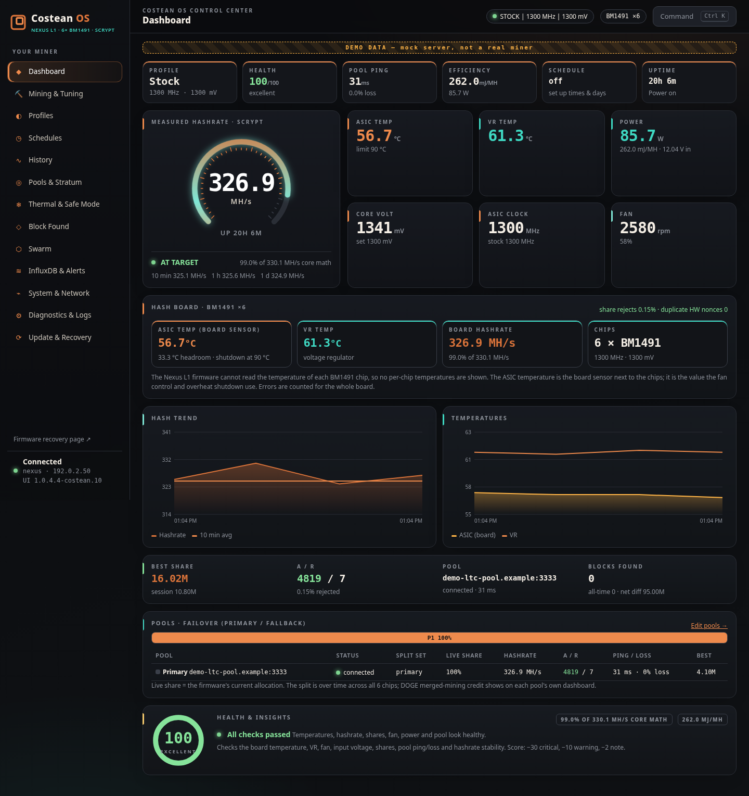
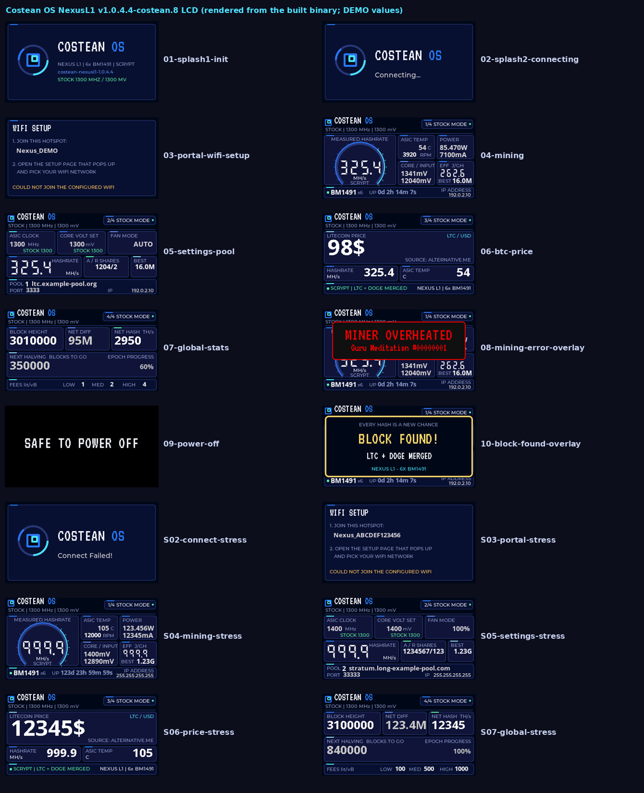
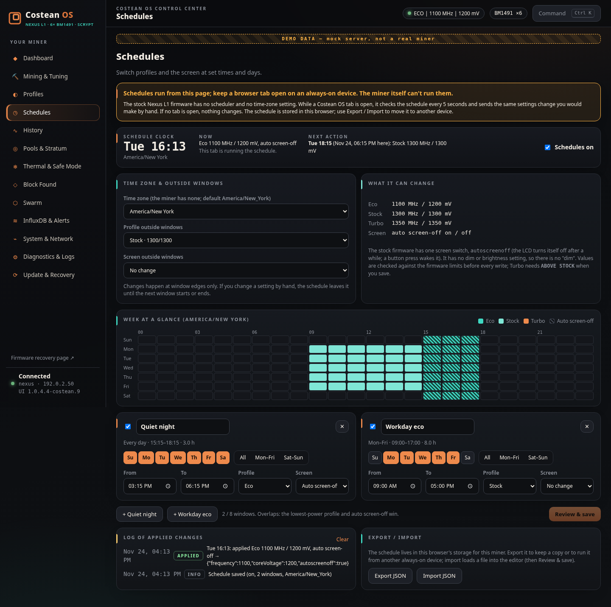

# Costean OS for the BitLuck Nexus L1

Version: **v1.0.4.4-costean.9** (experimental). Downloads are on the [Releases](../../releases/latest) page.

> [!WARNING]
> **EXPERIMENTAL. For the BitLuck Nexus L1 (6x BM1491, ESP32-S3, 16 MB flash, 320x170 LCD) only.** Do not flash it on any other board. Flash at your own risk and keep the stock files handy (see [Recovery](#recovery-back-to-stock-v1044)).

**Not affiliated with, or endorsed by, BitLuck.**

costean.9 is the field-tested costean.4 / costean.6 firmware with the costean.8 LCD artwork (6x BM1491), plus the Costean OS control center web UI in the copper **Lode** theme, now with Profiles, Schedules and History. The app (firmware + LCD) is byte for byte the same as costean.8; only the web UI changed.

- **App (firmware + LCD):** the costean.4 app (BitLuck nexus.v1.0.4.4 with the Costean OS LCD screen layout). As in costean.7, **only the pixel data of the built-in LCD background images was repainted**. The small leftover tag next to COSTEAN OS is gone, and the hash board text reads **6x BM1491**, matching the 6 chips the firmware drives. Each image keeps the same size, format, byte length and location. No code, layout or label bytes are changed, and only the image checksum and hash are recomputed. Mining, ASIC, power, fan and protection code are stock. The app reports version `costean-nexusl1-1.0.4.4`, and stock defaults are 1300 MHz / 1300 mV.
- **Web UI:** the Costean OS control center, labelled costean.9, in the copper Lode theme. It shows the 6 chips the firmware reports.

## Web UI (Costean OS control center)

- **Dashboard**: a summary strip (profile, health score, pool ping / loss, efficiency, next scheduled change, uptime), hashrate gauge, ASIC (board sensor) and VR temperatures, power and efficiency, core voltage, clock, fan, a 6x BM1491 hash board card, trends, pools with ping / loss, and a health & insights panel with a 0–100 score. There are no per-chip temperatures, because the firmware cannot read them.
- **Mining & Tuning**: stock 1300 / 1300 in one click. Every change asks you to confirm first.
- **Profiles**: Eco / Stock / Turbo from the firmware's own values (eco 1100 / 1200, stock 1300 / 1300, Turbo one firmware step above stock, at most +50 MHz / +50 mV and always inside the firmware limits). The active profile is worked out from the applied frequency and voltage. Turbo asks you to type `ABOVE STOCK`.
- **Schedules** (separate tab): switch profile and the LCD auto screen-off at set times and days. See [Schedules](#schedules) below.
- **History**: the miner's own last 3 hours (read from the firmware), plus 15-minute averages kept in your browser for 30 days. CSV export.
- **Pools & Stratum**: 2 pools (primary + fallback), Failover or Dual pool with a 1–99 % split.
- **Thermal & Safe Mode**: fan, overheat, LCD flip and auto-off.
- **Block Found**, **Swarm**, and **InfluxDB & Alerts** (Discord webhook, test alert, browser notifications).
- **System & Network** (incl. Ethernet DHCP / static IP for boards with a port), **Diagnostics & Logs**, and **Update & Recovery** (backup/restore without passwords, OTP).
- Command palette (Ctrl K). No per-page license footer.
- After a web UI update, the page checks `version.json` on the miner. If the miner has a different web UI version than the open page, the page reloads once to load it.

## Schedules

The stock Nexus L1 firmware has no scheduler and no time-zone setting, and Costean OS does not change the firmware code. So **schedules run from the web page**:

> Schedules run from this page; keep a browser tab open on an always-on device. The miner itself can't run them.

- No extra hardware or helper program: just a browser tab (an old phone, tablet, or a PC that stays on).
- Up to 8 windows (days + from / to, overnight allowed, `start = end` = all day). Each window picks a profile (Eco / Stock / Turbo or no change) and/or the screen (stays on / auto screen-off). Outside the windows you can pick a base profile and screen, or leave things as they are.
- Overlaps: the lowest-power profile wins, and auto screen-off wins over screen-on.
- The open page checks every 5 seconds and sends the same settings change you would make by hand, only at window edges (a manual change stays until the next edge), and only if the miner is not already there. Values are checked against the firmware limits before every write. Errors are retried every minute.
- Time zone: your pick, default America/New_York (DST handled by the browser). In the spring-forward gap a window starting at e.g. 02:30 takes effect at 03:00; in the repeated fall-back hour, a window in that hour can run twice.
- The schedule, the log of applied changes and the browser history are stored in that browser (per miner). Use Export / Import (JSON) to move them. One tab per browser runs it; other tabs defer.
- Screen: the firmware has one switch, auto screen-off. It has no LCD dim or brightness setting.
- With OTP enabled, the tab needs an open OTP session to write.

## Downloads

| File | What it is |
| --- | --- |
| `esp-miner-factory-NexusL1-v1.0.4.4-costean.9.bin` | Full 16 MB image for a **USB** install at offset **0x0**. |
| `costean-nexusl1-factory-v1.0.4.4-costean.9.zip` | The same factory image, zipped. |
| `esp-miner-NexusL1.bin` | App only, for **OTA** (costean.4 app with the repainted LCD images; identical to costean.8). |
| `www.bin` | Web UI only, for **OTA** (SPIFFS, 3 MB). |

Check the files first: `sha256sum -c SHA256SUMS`

## Install

- **OTA (keeps settings):** coming from costean.8, upload only `www.bin` (the app is unchanged). From anything older, upload **both** files: first `esp-miner-NexusL1.bin` (app with the LCD artwork), wait for the reboot, then `www.bin` (web UI).
- **USB (clean install, resets Wi-Fi and pools):**
  `esptool --chip esp32s3 write-flash 0x0 esp-miner-factory-NexusL1-v1.0.4.4-costean.9.bin`
  Then set up Wi-Fi from the `Nexus_…` hotspot (`192.168.4.1`).

The stock "check for updates on GitHub" button installs the official BitLuck release, which removes Costean OS.

## Recovery: back to stock v1.0.4.4

| Stock file | SHA-256 |
| --- | --- |
| `esp-miner-factory-NexusL1-v1.0.4.4.bin` | `6e9d438f0fb9130ba516ff8b5c5d83eb06d37b316253acd04ae53af26a47e9fe` |
| `esp-miner-NexusL1.bin` | `9044be236f5e514f1cb688fa38f9f4e3a98a2d9753ce43c2e3eab5872c5a125d` |
| `www.bin` | `f477d8aab900d4ab3829ac84fce780034577530e402eab00c8da5d3024019885` |

- **USB:** `esptool --chip esp32s3 write-flash 0x0 esp-miner-factory-NexusL1-v1.0.4.4.bin`
- **OTA:** upload the stock app, then the stock `www.bin`.

## Flash layout (same as stock)

| Name | Offset | Size |
| --- | --- | --- |
| nvs | 0x9000 | 24 KB |
| phy_init | 0xf000 | 4 KB |
| factory | 0x10000 | 4 MB (app 3,127,024 B) |
| www | 0x410000 | 3 MB |
| ota_0 / ota_1 | 0x710000 / 0xb10000 | 4 MB each |
| otadata | 0xf10000 | 8 KB |
| coredump | 0xf12000 | 64 KB |

## Build

The whole chain reproduces the release files byte for byte, starting from the official BitLuck `esp-miner-NexusL1.bin` (nexus.v1.0.4.4, SHA-256 `9044be23…5a125d`).

1. **costean.4 LCD layout:** `python3 tools/lcd/costean4-layout/patch_app8_costean.py <stock esp-miner-NexusL1.bin> costean4.bin`
   - Gives SHA-256 `b77b7c57…41304e`.
   - Writes the Costean label positions, text colours, LCD images, version string and recovery page into the stock app.
   - Every patched instruction is decoded and checked before it is written.
2. **LCD art (costean.8+):** `python3 tools/lcd/patch_images.py costean4.bin tools/lcd/art esp-miner-NexusL1.bin`
   - Changes only the pixel data of the 9 LCD images. It refuses any other byte, and recomputes the image checksum and hash.
   - The art is drawn by `tools/lcd/lcd-bgmain.cpp` (LVGL 8.3 host render).
3. **Web UI:** `cd web && npm ci && npm test && npm run build`, then:
   `spiffsgen.py 0x300000 web/dist/axe-os www.bin --page-size 256 --block-size 4096 --obj-name-len 64 --meta-len 4 --use-magic --use-magic-len`
   The browser tests (`node e2e/shots.mjs`, `node e2e/shots-block.mjs`) run against a demo mock API only.
4. **Factory image:** `python3 tools/make_factory.py <stock esp-miner-factory-NexusL1-v1.0.4.4.bin> esp-miner-NexusL1.bin www.bin esp-miner-factory-NexusL1-v1.0.4.4-costean.9.bin`

More screenshots (all demo data, never a real miner) are in [`docs/screenshots/`](docs/screenshots/).

## License

The stock firmware is © BitLuck, built on the GPL-3.0 ESP-Miner project. The Costean OS web UI and LCD artwork are GPL-3.0. The fonts are VT323 and Montserrat (SIL OFL).
