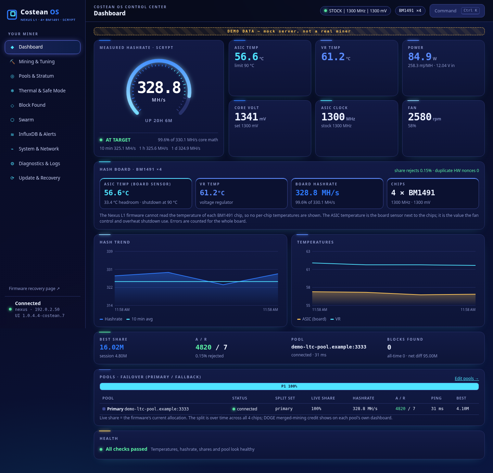
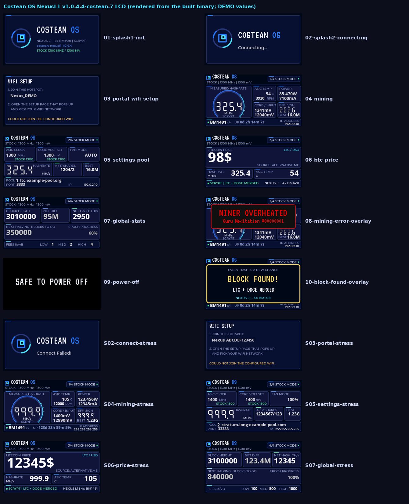

# Costean OS for the BitLuck Nexus L1

Version: **v1.0.4.4-costean.7** (experimental). Downloads are on the [Releases](../../releases/latest) page.

> [!WARNING]
> **EXPERIMENTAL. For the BitLuck Nexus L1 (4x BM1491, ESP32-S3, 16 MB flash, 320x170 LCD) only.** Do not flash it on any other board. Flash at your own risk and keep the stock files handy (see [Recovery](#recovery-back-to-stock-v1044)).

**Not affiliated with, or endorsed by, BitLuck.**

costean.7 is the field-tested costean.4 / costean.6 firmware with corrected LCD artwork, plus the Costean OS control center web UI.

- **App (firmware + LCD):** the costean.4 app (BitLuck nexus.v1.0.4.4 with the Costean OS LCD screen layout). For costean.7, **only the pixel data of the built-in LCD background images was repainted**. The small leftover tag next to COSTEAN OS is gone, and the hash board text now reads **4x BM1491** (it said 6x before). Each image keeps the same size, format, byte length and location. No code, layout or label bytes are changed, and only the image checksum and hash are recomputed. Mining, ASIC, power, fan and protection code are stock. The app reports version `costean-nexusl1-1.0.4.4`, and stock defaults are 1300 MHz / 1300 mV.
- **Web UI:** the Costean OS control center, labelled costean.7.

## Web UI (Costean OS control center)

- **Dashboard**: hashrate gauge, ASIC (board sensor) and VR temperatures, power and efficiency, core voltage, clock, fan, a 4x BM1491 hash board card, trends, pools and health. There are no per-chip temperatures, because the firmware cannot read them.
- **Mining & Tuning**: stock 1300 / 1300 in one click. Every change asks you to confirm first.
- **Pools & Stratum**: 2 pools (primary + fallback), Failover or Dual pool with a 1–99 % split.
- **Thermal & Safe Mode**: fan, overheat, LCD flip and auto-off.
- **Block Found**, **Swarm**, and **InfluxDB & Alerts** (Discord webhook, test alert, browser notifications).
- **System & Network**, **Diagnostics & Logs**, and **Update & Recovery** (backup/restore without passwords, OTP).
- Command palette (Ctrl K). No per-page license footer.
- After a web UI update, the page checks `version.json` on the miner. If the miner has a different web UI version than the open page, the page reloads once to load it.

## Downloads

| File | What it is |
| --- | --- |
| `esp-miner-factory-NexusL1-v1.0.4.4-costean.7.bin` | Full 16 MB image for a **USB** install at offset **0x0**. |
| `costean-nexusl1-factory-v1.0.4.4-costean.7.zip` | The same factory image, zipped. |
| `esp-miner-NexusL1.bin` | App only, for **OTA** (costean.4 app with the repainted LCD images). |
| `www.bin` | Web UI only, for **OTA** (SPIFFS, 3 MB). |

Check the files first: `sha256sum -c SHA256SUMS`

## Install

- **OTA (keeps settings):** upload **both** files. First `esp-miner-NexusL1.bin` (app with the new LCD artwork), wait for the reboot, then `www.bin` (web UI).
- **USB (clean install, resets Wi-Fi and pools):**
  `esptool --chip esp32s3 write-flash 0x0 esp-miner-factory-NexusL1-v1.0.4.4-costean.7.bin`
  Then set up Wi-Fi from the `Nexus_…` hotspot (`192.168.4.1`).

The stock "check for updates on GitHub" button installs the official BitLuck release, which removes Costean OS.

## Recovery: back to stock v1.0.4.4

| Stock file | SHA-256 |
| --- | --- |
| `esp-miner-factory-NexusL1-v1.0.4.4.bin` | `6e9d438f0fb9130ba516ff8b5c5d83eb06d37b316253acd04ae53af26a47e9fe` |
| `esp-miner-NexusL1.bin` | `9044be236f5e514f1cb688fa38f9f4e3a98a2d9753ce43c2e3eab5872c5a125d` |
| `www.bin` | `f477d8aab900d4ab3829ac84fce780034577530e402eab00c8da5d3024019885` |

- **USB:** `esptool --chip esp32s3 write-flash 0x0 esp-miner-factory-NexusL1-v1.0.4.4.bin`
- **OTA:** upload the stock app, then the stock `www.bin`.

## Flash layout (same as stock)

| Name | Offset | Size |
| --- | --- | --- |
| nvs | 0x9000 | 24 KB |
| phy_init | 0xf000 | 4 KB |
| factory | 0x10000 | 4 MB (app 3,127,024 B) |
| www | 0x410000 | 3 MB |
| ota_0 / ota_1 | 0x710000 / 0xb10000 | 4 MB each |
| otadata | 0xf10000 | 8 KB |
| coredump | 0xf12000 | 64 KB |

## Build

The whole chain reproduces the release files byte for byte, starting from the official BitLuck `esp-miner-NexusL1.bin` (nexus.v1.0.4.4, SHA-256 `9044be23…5a125d`).

1. **costean.4 LCD layout:** `python3 tools/lcd/costean4-layout/patch_app8_costean.py <stock esp-miner-NexusL1.bin> costean4.bin`
   - Gives SHA-256 `b77b7c57…41304e`.
   - Writes the Costean label positions, text colours, LCD images, version string and recovery page into the stock app.
   - Every patched instruction is decoded and checked before it is written.
2. **costean.7 LCD art:** `python3 tools/lcd/patch_images.py costean4.bin tools/lcd/art esp-miner-NexusL1.bin`
   - Changes only the pixel data of the 9 LCD images. It refuses any other byte, and recomputes the image checksum and hash.
   - The art is drawn by `tools/lcd/lcd-bgmain.cpp` (LVGL 8.3 host render).
3. **Web UI:** `cd web && npm ci && npm test && npm run build`, then:
   `spiffsgen.py 0x300000 web/dist/axe-os www.bin --page-size 256 --block-size 4096 --obj-name-len 64 --meta-len 4 --use-magic --use-magic-len`
   The browser tests (`node e2e/shots.mjs`, `node e2e/shots-block.mjs`) run against a demo mock API only.
4. **Factory image:** `python3 tools/make_factory.py <stock esp-miner-factory-NexusL1-v1.0.4.4.bin> esp-miner-NexusL1.bin www.bin esp-miner-factory-NexusL1-v1.0.4.4-costean.7.bin`

More screenshots (all demo data, never a real miner) are in [`docs/screenshots/`](docs/screenshots/).

## License

The stock firmware is © BitLuck, built on the GPL-3.0 ESP-Miner project. The Costean OS web UI and LCD artwork are GPL-3.0. The fonts are VT323 and Montserrat (SIL OFL).
